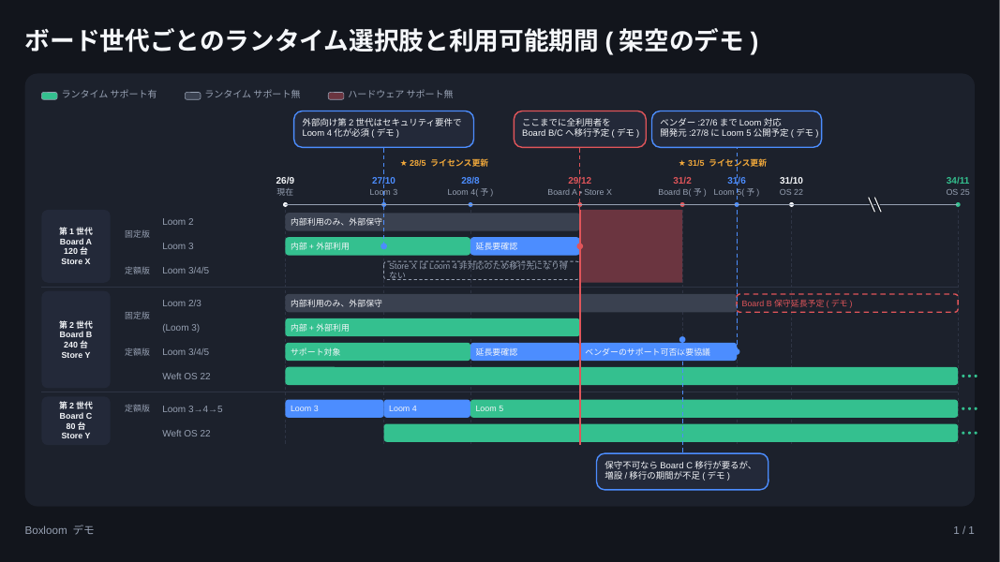
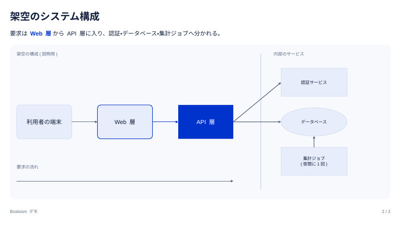

# Boxloom

**A self-hostable engine that turns semantic content into native, editable PowerPoint (PPTX).**
AI agents and developers write *what the content is* — points, a comparison of options,
a dated plan — and Boxloom produces a real `.pptx` whose layout, colors and type come from
a template. No coordinates, no hex colors, no font sizes in the input.



> Status: early (IR v0.1). Not yet published as a release; APIs marked stable in
> [`docs/library.md`](docs/library.md) may still change before 1.0.

## Why

Slides generated by AI fail in three different ways: mechanical breakage (overlaps,
overflowing text, uneven spacing), poor visual taste, and poor judgement of density and
structure. Boxloom answers each one structurally:

- **A layout engine instead of coordinates.** Content is laid out in nested boxes, so
  elements cannot overlap. Text is measured with per-font metrics before anything is
  drawn, and overflow is reported, never silently shrunk.
- **Semantic tokens instead of free styling.** Authors cannot pick colors or sizes.
  Templates map role names (`accent`, `danger`, `text_muted`, …) and a fixed type scale
  to real values.
- **A closed vocabulary of patterns, chosen by explicit rules.** Content is classified
  first (comparison, plan, process, …) and rendered by a pattern built for it. A raw-shape
  canvas exists only as a documented last resort.

Boxloom does **not** try to be a web slide editor. It is infrastructure: a library and a
CLI you run in your own environment — useful when data cannot be sent to a SaaS, or when
you build your own agent and need a deterministic PPTX backend.

## What you get

- **Native PPTX.** Titles are real layout placeholders, text is real text, tables are
  real tables, images are real pictures (with alt text), and connectors are real
  connectors, so the result stays editable as ordinary slides.
  Output is validated against the ECMA-376 schemas and opened with LibreOffice in CI;
  a compatibility matrix for PowerPoint, Keynote and Google Slides is in progress.
- **Strict input with useful errors.** Unknown blocks, attributes and keys are errors.
  Every error and warning has one shape:
  `{file, line, column, path, code, message, expected, hint}`, so an agent can branch on
  `code` and fix its own output.
- **Measured density.** `check` reports how much room is left on each slide
  (`capacity`) and which block overflows by how many points.
- **Subsystems for complex figures.** A Gantt chart and a constrained raw-shape canvas are
  included. Subsystems declare their natural, minimum and maximum size, and the layout
  engine negotiates with them.
- **Tables, images and parallel groups as plain Markdown.** GFM tables, ``
  images (PNG/JPEG, alt text required, paths relative to the deck) and `::::columns`;
  widths and alignment come from the template, never from the content. As a library,
  images are read only from an `fs.FS` you pass (`BuildOptions.Assets`).
- **Zero dependencies.** Go standard library only.



## Quick start

Requires Go 1.24+.

```sh
git clone <this repository> boxloom && cd boxloom/boxloom

# Write a deck (or use an example)
cat > /tmp/hello.bx.md <<'EOF'
---
title: Moving the reporting service
template: light
---

# The old cluster loses vendor support in March 2028

- The vendor ends security fixes on **2028-03-31**
- 14 services still run there; 9 can move without code changes

:::::compare
::::option Keep the old cluster
:::pros
- No migration work this year
:::
:::cons
- No security fixes after March 2028
:::
::::
::::option Move to the new cluster
:::pros
- Supported until 2033
:::
:::cons
- About six weeks of work per service group
:::
::::
:::::
EOF

go run ./cmd/boxloom check /tmp/hello.bx.md          # errors and warnings
go run ./cmd/boxloom build -o /tmp/hello.pptx /tmp/hello.bx.md
```

More examples are in [`examples/md`](examples/md) (Markdown) and
[`examples/ir`](examples/ir) (the JSON intermediate representation).

## Commands

Run them from `boxloom/` as `go run ./cmd/boxloom <command>`:

| Command | What it does |
|---|---|
| `schema [-template NAME]` | Prints one JSON document describing everything the templates accept. Give it to an AI before it writes. |
| `parse FILE.bx.md` | Markdown → IR (JSON). |
| `check [-format json] [-capacity] FILE` | Validates syntax and meaning, runs layout, and reports warnings and per-slide capacity. |
| `build [-o OUT.pptx] [-template NAME] FILE` | Builds the PPTX from `.bx.md` or `.json`. |

`-template` takes a bundled template name (`light`, `dark`) or a path to your own value
table, e.g. `-template ./my.json` (see [`examples/templates/forest.json`](examples/templates/forest.json)
and [`docs/template-values.md`](docs/template-values.md)). `schema`, `check` and `fonts`
accept it too.
| `fonts` | Lists the font metrics shipped with Boxloom and checks font-substitution margins. |

## Using it from an AI agent

1. Give the agent [`skills/boxloom/SKILL.md`](skills/boxloom/SKILL.md) (how to write
   decks, how to choose patterns, density limits, how to fix `check` output) and the
   output of `boxloom schema`.
2. Let it write `.bx.md` (or IR JSON for structured output).
3. Loop `check -format json` → fix until there are no errors and no `layout-overflow`.
4. `build`.

## Using it as a Go library

```go
import "boxloom"

deck, issues, err := boxloom.ParseMarkdown("deck.bx.md", src)
// handle issues / err
var buf bytes.Buffer
res, err := boxloom.Build(&buf, deck, boxloom.BuildOptions{Template: "light"})
```

The stable API (`ParseMarkdown`, `MarkdownToIR`, `ReadIR`, `ReadDeck`, `Check`, `Build`,
`Schema`, `Templates`) is described in [`docs/library.md`](docs/library.md). A complete
external-module example is in [`boxloom/examples/libuse`](boxloom/examples/libuse).

## Documentation

Design documents are written in Japanese.

| Document | Topic |
|---|---|
| [`docs/vision.md`](docs/vision.md) | Why Boxloom exists, positioning, risks |
| [`docs/patterns.md`](docs/patterns.md) | The pattern vocabulary and the rules for choosing one |
| [`docs/content-syntax.md`](docs/content-syntax.md) | The Markdown dialect |
| [`docs/ir.md`](docs/ir.md), [`schema/`](schema) | The JSON IR and its JSON Schema |
| [`docs/subsystem.md`](docs/subsystem.md) | The subsystem interface (Gantt, shapes, process, orgchart, matrix, funnel) |
| [`docs/template-values.md`](docs/template-values.md), [`docs/fonts.md`](docs/fonts.md) | Templates, scales, fonts and metrics |
| [`docs/build.md`](docs/build.md), [`docs/library.md`](docs/library.md) | Building PPTX, the Go API |
| [`CLAUDE.md`](CLAUDE.md) | Design principles in short form |

## Contributing

See [`CONTRIBUTING.md`](CONTRIBUTING.md). In short, code contributions are welcome
broadly. New patterns and changes to how templates look are decided by a small group of
maintainers who own the visual direction.

## License

Boxloom is licensed under the [Apache License, Version 2.0](LICENSE).
