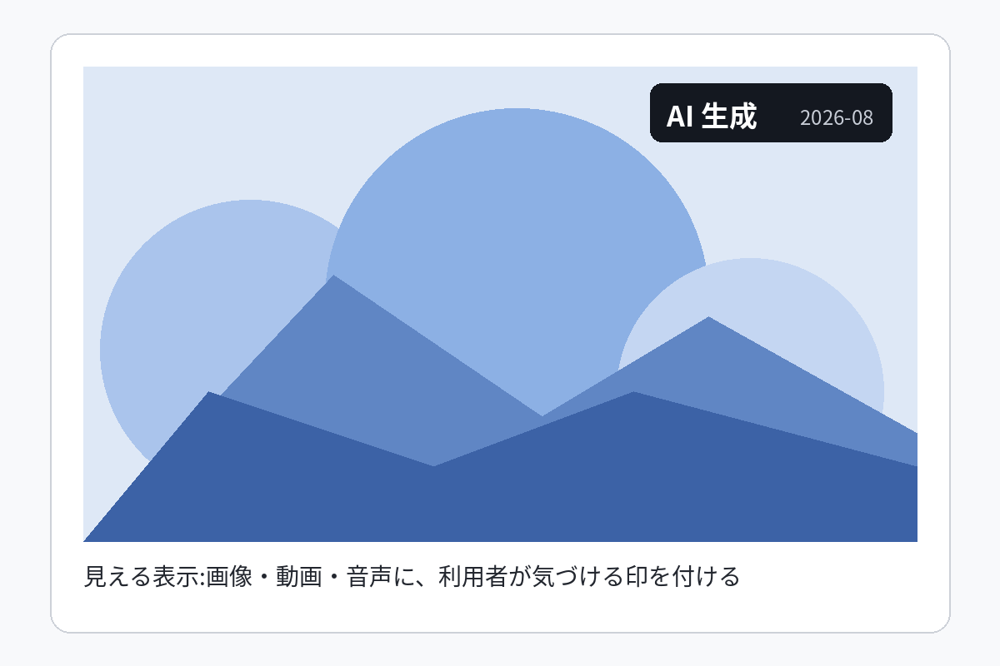
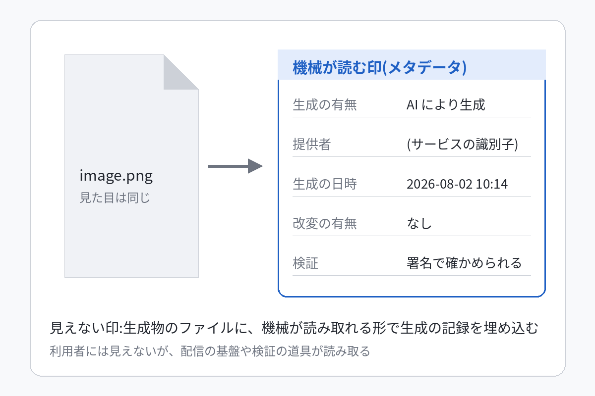

:::notes
この資料は Boxloom の見本。意味だけを Markdown で書き、見た目はテンプレートが決めている。
数字は 2024〜2026 年に公表された国際機関・大学・公的統計・調査会社の報告書から取り、各スライドの出典欄に機関名と年を書いた。
:::

# 要約:AI の影響はすでに測れる段階にあり、差は技術ではなく備えで開く

- **雇用**:世界の雇用の約 4 割、先進国では 6 割が AI の影響を受ける(IMF、2024 年)
  - 多くは置き換えではなく仕事の中身の変化で、事務職と女性に偏る(ILO、2025 年)
- **経済**:現場の実証では生産性が平均 14% 上がったが、マクロの効果の推計は年 0.1〜1.5 ポイントと幅がある
  - 2025 年の民間 AI 投資は米国 2,859 億ドルで中国の 23 倍。備えの指数も先進国 0.68 に対し低所得国 0.32
- **企業**:9 割近くが AI を使うが、利益への効果を確かめたのは 4 割、高い成果は 6%(McKinsey、2025 年)
- **基盤**:データセンターの電力は 2030 年に倍増(IEA、2025 年)。同じ性能の推論の費用は 2 年で 280 分の 1
- **社会**:選挙への偽情報の被害は予想より小さく、教育と著作権の制度は利用の広がりに追いついていない
  - 世論は国で割れ、米国では「利点が多い」が 39%、専門家と市民の見方の差は 50 ポイント
- **ガバナンス**:EU・中国・日本・韓国・米国で 2024〜2028 年に施行が続き、EU の高リスク規制は 2027 年末へ延びた

:::takeaway
差を生むのは技術の有無ではなく、**技能・電力・統制**への備えの速さである
:::

:::notes
最初に結論を言い切る。各項目の根拠はこのあとの 4 部で 1 枚ずつ示す。
:::

# 影響は 4 つの入口から 3 つの使う場を通って社会に広がる

```shapes
aspect: 2.6
items:
  - {kind: text, x: 0, y: 0, w: 0.2, h: 0.08, text: 入口(資源), textStyle: small, color: text_muted}
  - {kind: text, x: 0.3, y: 0, w: 0.2, h: 0.08, text: 変換, textStyle: small, color: text_muted}
  - {kind: text, x: 0.56, y: 0, w: 0.2, h: 0.08, text: 使う場, textStyle: small, color: text_muted}
  - {kind: text, x: 0.8, y: 0, w: 0.2, h: 0.08, text: 社会への影響, textStyle: small, color: text_muted}
  - {id: compute, kind: roundRect, x: 0, y: 0.1, w: 0.17, h: 0.17, text: 計算資源と電力, textStyle: subPoint, line: grid}
  - {id: data, kind: roundRect, x: 0, y: 0.32, w: 0.17, h: 0.17, text: データ, textStyle: subPoint, line: grid}
  - {id: talent, kind: roundRect, x: 0, y: 0.54, w: 0.17, h: 0.17, text: 人材と技能, textStyle: subPoint, line: grid}
  - {id: capital, kind: roundRect, x: 0, y: 0.76, w: 0.17, h: 0.17, text: 資本(投資), textStyle: subPoint, line: grid}
  - {id: model, kind: rect, x: 0.3, y: 0.38, w: 0.17, h: 0.24, text: [モデルと, 製品・サービス], textStyle: body, fill: accent, textColor: on_conditional}
  - {id: firms, kind: rect, x: 0.56, y: 0.1, w: 0.17, h: 0.2, text: 企業の導入, textStyle: subPoint, line: grid}
  - {id: public, kind: rect, x: 0.56, y: 0.4, w: 0.17, h: 0.2, text: 公共サービス, textStyle: subPoint, line: grid}
  - {id: people, kind: rect, x: 0.56, y: 0.7, w: 0.17, h: 0.2, text: 個人の利用, textStyle: subPoint, line: grid}
  - {id: eco, kind: rect, x: 0.8, y: 0.1, w: 0.2, h: 0.2, text: [雇用・生産性, 投資], textStyle: subPoint, line: grid}
  - {id: infra, kind: rect, x: 0.8, y: 0.4, w: 0.2, h: 0.2, text: [教育・医療, 電力の需要], textStyle: subPoint, line: grid}
  - {id: info, kind: rect, x: 0.8, y: 0.7, w: 0.2, h: 0.2, text: [情報・著作権, 世論], textStyle: subPoint, line: grid}
  - {kind: connector, from: compute, to: model, arrow: true}
  - {kind: connector, from: data, to: model, arrow: true}
  - {kind: connector, from: talent, to: model, arrow: true}
  - {kind: connector, from: capital, to: model, arrow: true}
  - {kind: connector, from: model, to: firms, arrow: true, color: accent}
  - {kind: connector, from: model, to: public, arrow: true, color: accent}
  - {kind: connector, from: model, to: people, arrow: true, color: accent}
  - {kind: connector, from: firms, to: eco, arrow: true}
  - {kind: connector, from: public, to: infra, arrow: true}
  - {kind: connector, from: people, to: info, arrow: true}
  - {kind: text, x: 0.3, y: 0.93, w: 0.7, h: 0.07, text: ガバナンス(規制と執行の体制)は、変換から影響までの全体に掛かる, textStyle: small, color: text_muted}
```

この資料は、この流れの順に **第 1 部 雇用と経済**、**第 2 部 基盤**、**第 3 部 社会**、**第 4 部 ガバナンスと提言** で見ていく。

:::notes
図は本資料の整理の枠組みで、出典のある数字ではない。入口が分かれて 1 つに集まり、そこから 3 つに分かれるので、箇条や手順の型では表せず、図形の逃げ道で描いた。
:::

# 第 1 部 雇用と経済 {type=section}

# 世界の雇用の約 4 割が AI の影響を受け、先進国では 6 割に達する

```chart
compare: item
unit: "%"
categories: [先進国, 新興国, 低所得国]
emphasis: [先進国]
series:
  - name: AI にさらされる雇用の割合
    values: [60, 40, 26]
```

- 先進国でさらされる職の約半分は AI が仕事を補う側で、残りの半分は置き換えのおそれがある
- 生成 AI に絞った ILO の指数では、世界の雇用の 25%(高所得国 34%)がさらされ、最も高い段階は 3.3%

:::quote IMF 専務理事のブログ、2024 年 1 月 14 日(訳)
AI は世界の雇用のほぼ 4 割に影響を与え、一部を置き換え、一部を補う。
:::

:::source
IMF Staff Discussion Note「Gen-AI: Artificial Intelligence and the Future of Work」(2024 年 1 月)、ILO Working Paper 140(2025 年 5 月、ILO と NASK)
:::

:::notes
「さらされる(exposed)」は仕事の中の作業が AI でできる割合で、失われる職の数ではない。この区別を聞き手に先に伝える。
:::

# 2030 年までに生まれる職は失われる職を 7,800 万上回るが、技能の 4 割は入れ替わる

| 2025〜2030 年の見込み | 職の数 | いまの雇用に対する割合 |
| --- | --- | --- |
| 生まれる職 | 1 億 7,000 万 | 14% |
| 失われる職 | −9,200 万 | −8% |
| 純増 | 7,800 万 | 7% |
: 母数は 55 経済圏の正規雇用 12 億 {total=last}

- 雇用主の 86% が AI と情報処理技術が事業を変えると見込み、63% が技能の不足を最大の障壁に挙げた
- いまの技能の 39% が 2030 年までに古くなる(2020 年の調査では 57%)
- 生成 AI に最もさらされるのは事務職で、女性の雇用の 27.6% が影響を受ける(男性は 21.1%)
- 増える職の上位は農業・配送・建設・販売などの現場の仕事と、看護・介護・福祉の仕事
- 見込みは雇用主の回答に基づく予想で、実際に起きた変化の観測ではない

:::source
世界経済フォーラム「Future of Jobs Report 2025」(2025 年 1 月、雇用主 1,000 社超・1,410 万人の従業員)、ILO Working Paper 140(2025 年 5 月)
:::

# 現場の実証では生産性が 14% 上がり、恩恵は経験の浅い働き手に集中した

::::stat
:::value +14 {unit=%}
1 時間あたりに解決した問い合わせの数(担当者 5,179 人の平均)
:::
:::value +34 {unit=%}
経験が浅く技能の低い担当者の伸び。熟練者はほぼ変化なし
:::
:::value 26 / 50 {unit=%}
ソフトウェア開発・マーケティングの産出の伸び(別の実験の結果)
:::
::::

- 生成 AI の助言は熟練者のやり方を広め、新人が経験の曲線を早く上る
- 顧客の満足と担当者の定着も上がった。効果は作業が定型で結果を測れる仕事で大きい
- 効果は 1 社・1 業務の実験で、定型でない知識労働への当てはめには注意が要る
- 一方で 22〜25 歳のソフトウェア開発者の雇用は 2024 年から 20% 近く減り、入口の仕事から影響が出ている
- AI と働く労働者の 3 人に 2 人は、仕事が危険でなく退屈でもなくなったと答えている(OECD の 7 か国調査)

:::source
Brynjolfsson, Li, Raymond「Generative AI at Work」Quarterly Journal of Economics 140(2)、2025 年(NBER WP 31161、2023 年)。開発・マーケティングの数字は Stanford HAI「AI Index Report 2026」経済章、労働者の回答は OECD「Employment Outlook 2023」
:::

# マクロの生産性への効果の推計は年 0.1〜1.5 ポイントと幅があり、分かれ目は導入の速さ

| 出典(年) | 指標 | 年あたりの押し上げ |
| --- | --- | --- |
| Acemoglu(2024) | 全要素生産性 | 約 0.07 ポイント |
| OECD(2024) | 全要素生産性(米国、10 年) | 0.25〜0.6 ポイント |
| IMF(2026) | 世界の経済成長率 | 0.1〜0.8 ポイント(中心 0.5) |
| Goldman Sachs(2023) | 労働生産性(10 年) | 約 1.5 ポイント |
: 指標が違うので横に並べて比べるのは目安

- OECD の推計でも、過去数十年の OECD の生産性の伸び(年 1〜1.5%)に対しては大きな上乗せ
- 幅を決めるのは業種ごとの導入の速さで、知識集約の業種では 10 年で 15〜20% の伸び
- IMF は、期待どおりに生産性が上がらなければ株価の調整が起こりうると警告している

:::source
OECD AI Papers No. 29「Miracle or Myth?」(2024 年 11 月、Acemoglu と Goldman Sachs の推計の比較を含む)、IMF 専務理事の講演(2026 年 2 月 3 日)
:::

# AI を使う企業は 88% だが、利益への効果を確かめたのは 39%、高い成果は 6%

```funnel
stages:
  - {label: 1 つ以上の業務で AI を定期的に利用, value: "88%", note: 前年は 78%}
  - {label: 生成 AI を利用, value: "72%"}
  - {label: 全社の利益(EBIT)への効果を認める, value: "39%", note: その大半は 5% 未満}
  - {label: 高い成果(利益の 5% 超)を出す企業, value: "6%", emphasis: true, note: 業務の作り直しと経営の関与が共通点}
```

- 回答の 62% は AI エージェントを試しているが、全社に広げた段階の企業は少ない

:::source
McKinsey「The state of AI in 2025」(2025 年 11 月、回答 1,993・105 か国、調査は 2025 年 6〜7 月)
:::

:::notes
段の値は同じ調査の回答者全体に対する割合で、段の間の比率は書いていない(段ごとの定義が違うため)。
:::

# 投資は 2025 年に倍増し、米国の民間投資は中国の 23 倍に達した

```chart
compare: item
categories: [米国, 欧州, 中国]
emphasis: [米国]
series:
  - name: 2025 年の民間 AI 投資(億ドル)
    values: [2859, 209, 124]
```

- 企業の AI 投資の合計は 5,817 億ドルで前年の 2 倍超。民間投資は 3,447 億ドル(+127.5%)
- 生成 AI への投資は 200% 超の伸びで、民間 AI 投資の半分近くを占める
- 2024 年の時点でも米国 1,091 億ドルに対し中国 93 億ドル・英国 45 億ドルと、差は 1 年で広がった

:::source
Stanford HAI「AI Index Report 2026」経済章(2026 年 4 月)、同「AI Index Report 2025」(2025 年 4 月)
:::

# 第 2 部 基盤:計算資源・エネルギー・科学 {type=section}

# データセンターの電力は 2030 年に倍増するが、その 85% は米国・中国・欧州に集中する

```chart
compare: component
unit: "%"
categories: [米国, 中国, 欧州, その他]
emphasis: [米国]
series:
  - name: 2024 年のデータセンターの電力消費の地域別の割合
    values: [45, 25, 15, 15]
```

- 世界のデータセンターの電力消費は 2024 年の約 415 TWh(世界の約 1.5%)から 2030 年に約 945 TWh(約 3%)へ、年率約 15% で増える
- 2030 年までの増加の 8 割近くは米国と中国で、米国では電力需要の伸びの半分近くがデータセンター
- それでも世界の電力需要の伸びに占める割合は 1 割未満で、産業用モーターや空調より小さい

:::source
IEA「Energy and AI」(2025 年 4 月、基本ケース。高成長ケースは 2030 年に 1,260 TWh 超、低成長ケースは約 800 TWh)
:::

# 同じ性能の推論の費用は 2 年で 280 分の 1 になり、壁は費用から運用へ移った

::::stat
:::value 1/280
GPT-3.5 相当の性能の推論の費用。100 万トークンあたり 20 ドル(2022 年 11 月)から 0.07 ドル(2024 年 10 月)へ
:::
:::value −30 {unit=%/年}
ハードウェアの費用の低下
:::
:::value +40 {unit=%/年}
ハードウェアのエネルギー効率の改善
:::
::::

- 小さなモデルの性能が上がり、同じ水準の答えを得る費用が急速に下がった
- 2024 年の注目すべき新モデルの約 90% は産業界が作り、最先端のモデルと公開重みのモデルの差は縮まった
- 費用が下がると、使うかどうかはデータ・技能・統制の整備で決まるようになる
- 生成 AI の人口普及率は 3 年で 53% に達した。シンガポール 61%・UAE 64% に対し、米国は 28.3% で 24 位

:::source
Stanford HAI「AI Index Report 2025」第 1 章(2025 年 4 月、推論の費用は Epoch AI のデータ)、同「AI Index Report 2026」(2026 年 4 月、普及率)
:::

# 科学と医療では、受賞と承認という形で AI の成果が確認され始めた

::::stat
:::value 6 → 223 {unit=件}
FDA が承認した AI を使う医療機器の年間の件数(2015 年 → 2023 年)
:::
:::value 2 {unit=賞}
2024 年のノーベル賞(物理学賞は深層学習の基礎、化学賞はタンパク質の構造予測への応用)
:::
:::value 84 / 44 {unit=%}
医療への良い影響を期待する割合(米国の専門家 / 一般の人)
:::
::::

- 医療機器の承認は 8 年で 37 倍に増え、診断の支援が実用の段階に入った
- タンパク質の構造予測は創薬の時間を縮め、材料の探索にも同じ方法が広がっている
- 専門家と一般の人の期待の差は医療で 40 ポイントあり、説明と検証の積み重ねが要る
- 承認の件数は機器の数で、診断の精度や患者の転帰の改善を直接には示さない
- 公的な AI スーパーコンピュータは中国 85・欧州 44・北米 41 で、科学の計算資源も地域で偏る

:::source
Stanford HAI「AI Index Report 2025」(2025 年 4 月、FDA の承認件数とノーベル賞)、同「AI Index Report 2026」世論章(2026 年 4 月、専門家と一般の比較)
:::

# 第 3 部 社会:教育・情報・著作権・格差・世論 {type=section}

# 学生の 8 割が AI を使う一方、方針を持つ学校は半分で、教員の 6% しか方針を明確と感じていない

::::stat
:::value 80 {unit=%超}
学業に AI を使う米国の高校生・大学生
:::
:::value 1 / 2
AI の方針を持つ米国の中学・高校の割合
:::
:::value 6 {unit=%}
その方針を明確だと感じる教員
:::
:::value 10 {unit=%未満}
生成 AI の方針・指針を持つ学校と大学(2023 年 5 月、世界 450 校超の調査)
:::
::::

- UNESCO は 2023 年 9 月に初めての指針を出し、データ保護と 13 歳未満の利用の制限を各国に求めた
- 利用は制度より速く広がった。方針の有無より、方針が教室で分かる形になっているかが差になる
- 米国・カナダの AI 分野の博士の新規取得は 2022〜2024 年に 22% 増え、増えた分は産業界ではなく学界へ向かった

:::source
Stanford HAI「AI Index Report 2026」(2026 年 4 月)、UNESCO の調査(2023 年 5 月)と「Guidance for generative AI in education and research」(2023 年 9 月)
:::

# 選挙への AI 偽情報は最大のリスクと予想されたが、2024 年の結果を変えた証拠は無い

::::columns
:::column 予想(2024 年 1 月)
- 世界経済フォーラムの専門家 1,490 人は、今後 2 年の最大のリスクに **誤情報・偽情報** を挙げた
- 前年の調査では上位 10 に入っていなかった
- 2024 年は世界で選挙が集中し、AI による混乱が心配された
:::
:::column 観測(2024 年の選挙)
- 英国・フランス・欧州議会の選挙で AI 生成の偽情報の事例は **27 件**。結果に影響した証拠は無い
- 主要な選挙の期間に事実確認された誤情報のうち、AI 生成は **1% 未満**(大手の SNS 事業者の集計)
- 偽物と分かっていても信念を強める効果と、何が本物かへの信頼の侵食は残る
:::
::::

:::quote Alan Turing Institute CETaS の報告、2024 年 11 月(訳)
AI が選挙の結果を左右した証拠はいまも無い。しかし、何が本物で何が偽物かへの信頼が損なわれ続けていることを、我々は懸念している。
:::

:::source
WEF「Global Risks Report 2024」(2024 年 1 月)、Alan Turing Institute CETaS(2024 年 9 月・11 月)、Meta の報告(2024 年 12 月 3 日)
:::

# 著作権の訴訟は 1 年で倍増し、判断は「学習の仕方」で分かれ始めた

| 時期 | 出来事 | 意味 |
| --- | --- | --- |
| 2025 年 2 月 | 米国の連邦地裁が、判例の要約を学習に使った非生成 AI の fair use を否定 | 学習データの市場への害を認めた |
| 2025 年 5 月 | 米国著作権局が学習と fair use の報告書(第 3 部)を公表 | 「fair use になるものも、ならないものもある」 |
| 2025 年 6 月 | 書籍を学習に使った 2 件で、学習そのものは fair use と判断 | 海賊版の取得は別に責任を問う |
| 2025 年 9 月 | 書籍の著者の集団訴訟で 15 億ドルの和解(48 万冊、1 冊約 3,000 ドル) | 取得の仕方が賠償の規模を決めた |
| 2026 年 3 月 | 英国政府が報告書で、当面は著作権法を改正しないと決定 | 証拠が足りず、裁判所が現行法を当てる |
| 2026 年 9 月 | 米国の控訴裁が 2025 年 2 月の判断を維持 | 生成 AI の学習には判断を示さず |

- AI 企業への著作権侵害の訴訟は 2024 年末の約 30 件から 2025 年末に 70 件超へ増えた
- 音楽では 2025 年秋に大手レーベルと生成サービスの和解が続き、許諾つきの提供へ移り始めた
- 学習そのものより、取得の仕方と出力が市場を置き換えるかが、いまの判断の分かれ目

:::source
Copyright Alliance「AI Copyright Lawsuit Developments in 2025」(2026 年 1 月)、米国著作権局「Copyright and Artificial Intelligence」Part 3(2025 年 5 月)、英国政府「Copyright and Artificial Intelligence」報告書(2026 年 3 月)
:::

# 格差は国の備えの差として既に現れ、低所得国は接続の段階で遅れている

```chart
compare: item
unit: 点
categories: [先進国, 新興国, 低所得国]
emphasis: [低所得国]
series:
  - name: IMF の AI 準備度指数(0〜1、174 経済圏の平均)
    values: [0.68, 0.46, 0.32]
```

- 指数はデジタル基盤・人材と労働市場の制度・革新と経済への統合・規制と倫理の 4 つで測る
- インターネットを使う人は高所得国で 94%、低所得国で 23%。未接続の 22 億人の 96% は低・中所得国に住む
- 影響の少ない低所得国は、当面の混乱は小さいが、恩恵も取り逃がすおそれがある

:::source
IMF「AI Preparedness Index」(2024 年 6 月公開、公式ダッシュボードの値)、ITU「Facts and Figures 2025」(2025 年 11 月)
:::

# 世論は国で割れ、投資の大きい国ほど AI に慎重で、専門家と市民の差は 50 ポイントある

```chart
compare: item
unit: "%"
categories: [中国, インドネシア, タイ, メキシコ, インド, カナダ, 米国, オランダ]
emphasis: [米国]
series:
  - name: AI の製品とサービスは欠点より利点が多い(2024 年)
    values: [83, 80, 77, 70, 62, 40, 39, 36]
```

- 世界全体では「利点が多い」が 55%(2024 年)から 59%(2025 年)に上がったが、「不安」も 52% に増えた
- 米国では仕事への良い影響を期待する専門家が 73%、一般の人は 23%。自国政府の規制への信頼は 31%(世界平均 54%)

:::source
Stanford HAI「AI Index Report 2025」第 8 章(Ipsos の 2024 年調査)、同「AI Index Report 2026」世論章(2026 年 4 月)
:::

# 第 4 部 ガバナンスと提言 {type=section}

# EU の高リスク規制は 2027 年末へ延び、主要国の施行は 2028 年まで続く

```gantt
span: 2023-07 .. 2028-12
ticks:
  - {at: 2024-08, label: EU AI Act 発効}
  - {at: 2026-08, label: EU 一般適用, status: support}
  - {at: 2027-12, label: EU 高リスク, status: conditional}
milestones:
  - {at: 2025-12, label: 日本 AI 基本計画}
legend:
  support: 施行済み(2026 年 11 月時点)
  conditional: 施行予定
  none: 撤回・旧日程
  risk: 日程の見直しの審議
groups:
  - id: eu
    label: [EU, AI Act]
    risk: 2025-11 .. 2026-07
    rows:
      - label: 禁止行為
        segments:
          - {from: 2025-02, to: 2028-12, status: support, label: 適用中, openEnd: true}
      - label: 汎用 AI モデル
        segments:
          - {from: 2025-08, to: 2028-12, status: support, label: 義務の適用, openEnd: true}
      - label: 透明性・監督体制
        segments:
          - {from: 2026-08, to: 2028-12, status: support, label: 適用中, openEnd: true}
      - id: eu-highrisk
        label: 高リスク(Annex III)
        segments:
          - {from: 2026-08, to: 2027-12, status: none, label: 旧日程}
          - {from: 2027-12, to: 2028-12, status: conditional, label: 適用予定, openEnd: true}
  - id: us
    label: [米国]
    rows:
      - id: us-eo
        label: 連邦の大統領令
        segments:
          - {from: 2023-10, to: 2025-01, status: none, label: 前政権の大統領令}
          - {from: 2025-01, to: 2028-12, status: support, label: 推進の枠組み・行動計画, openEnd: true}
  - id: cn
    label: [中国]
    rows:
      - label: 生成 AI の規制
        segments:
          - {from: 2023-08, to: 2025-09, status: support, label: 暫定弁法}
          - {from: 2025-09, to: 2028-12, status: support, label: 生成物の表示弁法も施行, openEnd: true}
  - id: jpkr
    label: [日本・韓国]
    rows:
      - label: 日本 AI 推進法
        segments:
          - {from: 2025-06, to: 2028-12, status: support, label: 施行(罰則なし), openEnd: true}
      - label: 韓国 AI 基本法
        segments:
          - {from: 2025-01, to: 2026-01, status: conditional, label: 公布から施行まで}
          - {from: 2026-01, to: 2028-12, status: support, label: 施行(2026 年は猶予), openEnd: true}
annotations:
  - at: 2027-12
    target: eu-highrisk
    status: conditional
    text: [Omnibus で 2026 年 8 月から, 2027 年 12 月 2 日へ延期]
  - at: 2025-01
    target: us-eo
    status: none
    text: [前政権の大統領令を撤回し推進の枠組みへ, 2025 年 12 月の大統領令は州法への対抗を指示]
```

:::source
欧州委員会の AI Act のページ(2026 年 10 月更新)と各国の法令。製品組込みの高リスク AI は 2028 年 8 月から
:::

# EU AI Act の執行は、AI Office を中心に助言の 3 機関と各国当局で動く

```orgchart
root: {title: AI Office(欧州委員会), detail: 汎用 AI モデルの監督と各国の調整(第 64 条), emphasis: true}
units:
  - title: 欧州 AI 委員会
    detail: 加盟国の代表(第 65・66 条)
  - title: 諮問フォーラム
    detail: 産業・学界・市民社会(第 67 条)
  - title: 科学パネル
    detail: 独立の専門家。系統的リスクを警告(第 68 条)
  - title: 各国の所管当局
    detail: 加盟国が指定(第 70 条)
    status: conditional
    members:
      - {title: 通知当局, detail: 適合性評価機関の指定}
      - {title: 市場監視当局, detail: 高リスク AI の監督}
legend:
  conditional: 2026 年 8 月 2 日から監督を担う(高リスクは 2027 年 12 月から)
```

- 汎用 AI モデルは EU が直接、高リスクの AI は各国の当局が監督するという二層の分担

:::source
規則 (EU) 2024/1689 第 7 章(第 64〜70 条)、欧州委員会の AI Act のページ(2026 年 10 月更新)
:::

# 透明性の義務は、利用者に見える表示と機械が読む印の両方を求める

  

- EU は 2026 年 8 月から、中国は 2025 年 9 月から、韓国は 2026 年 1 月から、生成物の表示と AI との対話の開示を義務にした
- 見える表示は利用者のため、機械が読む印は配信の基盤と検証の道具のため。両方が揃って初めて偽物の追跡ができる

:::note
画像は義務の内容を説明する模式図で、実在のサービスの画面ではない
:::

:::source
規則 (EU) 2024/1689 第 50 条、中国「AI 生成合成コンテンツ表示弁法」(2025 年 9 月施行)、韓国「AI 基本法」(2026 年 1 月施行)
:::

# 導入の成果は、試行から業務の作り直しまでの 6 段階を通せるかで決まる

```process
steps:
  - {title: 現状の棚卸し, detail: 用途と危険の一覧}
  - {title: 用途の選定, detail: 価値と危険で絞る}
  - {title: 試行, detail: 人が確認する運用で}
  - {title: 業務の作り直し, detail: 高成果企業を分ける段, emphasis: true}
  - {title: 全社展開, detail: 統制と技能が前提, status: conditional}
  - {title: 監視と見直し, detail: 事故と効果を測る}
legend:
  conditional: 統制と技能の整備が済んでから進む段
```

- 高い成果を出す 6% の企業に共通するのは、業務の作り直し・経営の関与・人の確認を含む統制で、道具の選び方ではない
- 多くの企業は 3 段目の試行で止まる。4 段目を越えるには、業務の責任者が設計を持つ必要がある
- 5 段目は統制(人の確認・事故の報告)と技能(研修)が整ってから進む。整う前に広げると事故が先に来る
- 6 段目は利益と事故の両方を測り、1 段目に戻って用途を入れ替える
- 効率だけを目的にする企業が 8 割で、高い成果の企業は成長と革新も目的に置いている

:::source
段階は作成者の整理。共通点は McKinsey「The state of AI in 2025」(2025 年 11 月)の高成果企業の分析による
:::

# 経営層は様子見ではなく、EU 水準の統制を全社で整える選択肢を取るべきだ

```matrix
columns: [様子見, 地域ごとに最低限, EU 水準で全社統一]
rows:
  - label: 2026 年 8 月からの透明性の義務
    cells:
      - {status: danger, text: 対応なし}
      - {status: support, text: 地域ごとに対応}
      - {status: support, text: 一度の対応で済む}
  - label: 2027 年 12 月からの高リスクの義務
    cells:
      - {status: danger, text: 間に合わない}
      - {status: conditional, text: 地域ごとに準備}
      - {status: support, text: 先に整う}
  - label: 複数の地域への展開
    cells:
      - {status: none}
      - {status: conditional, text: 地域ごとに作り直し}
      - {status: support, text: 共通の統制で広げる}
  - label: 初期の費用
    cells:
      - {status: support, text: 掛からない}
      - {status: conditional, text: 地域の数だけ掛かる}
      - {status: conditional, text: 先に掛かる}
  - label: 利用者と当局からの信頼
    cells:
      - {status: danger, text: 事故のときに失う}
      - {status: conditional, text: 地域で差が出る}
      - {status: support, text: 説明できる}
legend:
  support: 満たす
  conditional: 条件つき
  danger: 満たさない
  none: 関係しない
emphasis: EU 水準で全社統一
```

:::source
評価は作成者の判断。義務の時期は第 4 部の規制の時系列(欧州委員会の AI Act のページ、2026 年 10 月更新)による
:::

# 政策担当者は備えの指標を測り、技能・電力・透明性に先に手を打つべきだ

::::columns
:::column 経営層へ
- 利用の有無ではなく、利益と事故の両方を測る指標を置く
- 試行で止めず、業務の作り直しに責任者を付ける
- 透明性の義務(2026 年 8 月)を全社の共通の統制にする
- 経験の浅い人ほど効果が出るので、研修を新人に厚くする
- 学習データの取得と出力の管理を著作権の方針に書き、許諾つきの調達を優先する
:::
:::column 政策担当者へ
- IMF の準備度の 4 つの柱で自国の弱い柱を測り、そこに予算を向ける
- データセンターの電力を電源の計画に先に組み込む(2030 年に倍増)
- 学校の方針を「ある」から「教員に分かる」に引き上げる
- 偽情報は選挙の結果より信頼の侵食を測り、表示の義務を執行する
- 事故(インシデント)の報告を集め、規制の効果を件数で追う
:::
::::

:::takeaway
投資の額ではなく、**技能・電力・統制**の 3 つの備えが、各国と各社の差を決める
:::

:::notes
提言は第 1〜4 部の数字から作成者が導いたもので、出典のある事実と区別して話す。
:::

# AI の影響の大きさはまだ決まっていない。決めるのは今後 3 年の備えである {type=statement}

:::notes
EU の高リスク規制(2027 年 12 月)、データセンターの電力の倍増(2030 年)、技能の 4 割の入れ替わり(2030 年)がいずれも 3〜4 年の内に来る、という意味。
:::
