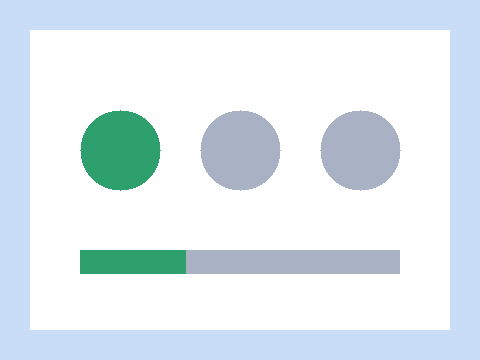
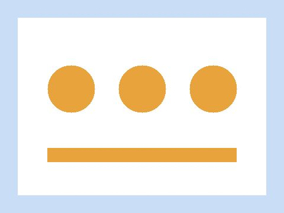

:::notes
このデコはすべて架空の会社・架空のサービスの話です。Boxloom のサブシステムの見本として使います。
:::

# 論点

- 架空の会社 Hoshizora が、データを外に出さない **セルフホスト型** の集計サービス Kumo を立ち上げる
- 2027年4月に限定公開、**2027年10月** に一般公開を目指す
- 一般公開の前に、認証まわりの外部監査を通す必要がある

:::note
数字・日付・組織はすべて架空のデモ
:::

# 第1部 なぜいま作るのか {type=section}

:::notes
第1部は、作る理由を数字と利用者の声で示す。
:::

# 外に出せないデータにも、集計の道具は要る {type=statement}

# 聞き取りの結果は、需要がはっきりあることを示している

::::stat
:::value 38 {unit=社}
聞き取りをした企業
:::
:::value 71 {unit=%}
「SaaS には業務のデータを送れない」と答えた割合
:::
:::value 3 → 1 {unit=週}
集計の手作業を道具で減らせる見込み
:::
::::

- 送れない理由は、社内の規程(16社)と取引先との契約(11社)が多かった
- 多くの企業が、表計算ソフトの手作業で毎週の集計をしている

:::takeaway
**自分の環境の中で動く** 集計の道具には、はっきりした需要がある
:::

# 現場は「外に出さずに済むこと」を最も重く見ている

:::quote 架空の製造業の情報システム担当、2026年10月の聞き取り
便利な道具はたくさんあるが、データを外に出す時点で社内の審査に半年かかる。\
中で動くなら、来月からでも試せる。
:::

- 38社のうち27社が、選ぶ条件の一番目に「データを外に出さないこと」を挙げた
- 価格を一番目に挙げたのは4社だけだった

# 第2部 何を作るか {type=section}

# システム構成

要求は **Web 層** から API 層に入り、認証・データベース・集計ジョブへ分かれる。

```shapes
aspect: 2.6
items:
  - {kind: text, x: 0, y: 0, w: 0.4, h: 0.1, text: 利用者の環境の中で動く, color: text_muted}
  - {kind: text, x: 0.7, y: 0, w: 0.3, h: 0.1, text: 内部のサービス, color: text_muted}
  - {kind: line, from: [0.665, 0.02], to: [0.665, 0.98], color: grid}
  - {id: arch-client, kind: roundRect, x: 0, y: 0.38, w: 0.15, h: 0.24, text: 利用者の端末, textStyle: body, line: grid}
  - {id: arch-web, kind: roundRect, x: 0.22, y: 0.38, w: 0.15, h: 0.24, text: Web 層, textStyle: body, line: accent}
  - {id: arch-api, kind: rect, x: 0.44, y: 0.38, w: 0.15, h: 0.24, text: API 層, textStyle: body, fill: accent, textColor: on_conditional}
  - {id: arch-auth, kind: rect, x: 0.72, y: 0.12, w: 0.18, h: 0.2, text: 認証サービス, line: danger}
  - {id: arch-db, kind: ellipse, x: 0.72, y: 0.4, w: 0.18, h: 0.2, text: データベース, line: grid}
  - {id: arch-jobs, kind: rect, x: 0.72, y: 0.68, w: 0.18, h: 0.2, text: [集計ジョブ, (夜間に1回)], line: grid}
  - {kind: connector, from: arch-client, to: arch-web, arrow: true}
  - {kind: connector, from: arch-web, to: arch-api, arrow: true, color: accent}
  - {kind: connector, from: arch-api, to: arch-auth, arrow: true, color: danger}
  - {kind: connector, from: arch-api, to: arch-db, arrow: true}
  - {kind: connector, from: arch-jobs, to: arch-db, arrow: true}
  - {kind: text, x: 0.72, y: 0.9, w: 0.28, h: 0.1, text: この色の枠は外部監査の対象, textStyle: small, color: danger}
```

# 導入の流れ

```process
caption: 利用者が Kumo を使い始めるまでの5段階
steps:
  - {title: 申し込み, detail: [窓口で受付, 1営業日]}
  - {title: 環境の確認, detail: [OS・メモリを, 自動で点検]}
  - {title: 導入, detail: ["**最も時間がかかる**", 平均5営業日], emphasis: true}
  - {title: 試験運用, detail: [2週間、, 実データの一部で]}
  - {title: 本番, detail: [保守契約を, 開始], status: support}
legend:
  support: 保守の係に引き継ぐ
```

- 申し込みから本番まで、いまは **平均4週間**
- 導入(3)を2営業日に縮めれば、限定公開の10社を3月中に受け入れられる

:::note
導入(3)を短くするのが限定公開までの最大の課題
:::

# 利用者の画面は3つの段階で進む

  

# 配布の形の比較

```matrix
columns: [コンテナ, 仮想マシン, 専用の機器]
rows:
  - label: 導入の速さ
    cells:
      - {status: support, text: 速い(1日)}
      - {status: conditional, text: 中(3日)}
      - {status: danger, text: 遅い(2週間)}
  - label: 利用者の負担
    cells:
      - {status: conditional, text: 運用の知識が要る}
      - {status: conditional, text: 中}
      - {status: support, text: 小さい}
  - label: 監査の通しやすさ
    cells:
      - {status: conditional, text: 要確認}
      - {status: support, text: 通しやすい}
      - {status: support, text: 通しやすい}
  - label: 原価
    cells:
      - {status: support, text: 低い}
      - {status: conditional, text: 中}
      - {status: danger, text: 高い}
legend:
  support: 良い
  conditional: 条件つき
  danger: 悪い
emphasis: コンテナ
```

# 限定公開は3つに絞り、残りは一般公開に回す

::::columns
:::column 限定公開でやること {role=main}
- 集計の画面と、週次の報告の自動化
- コンテナでの配布(導入は1日)
- 認証は社内のディレクトリにつなぐだけ

導入の速さを最優先にし、**10社に使ってもらう** ことを目標にする。
:::
:::column 一般公開まで
- 仮想マシンでの配布
- 外部監査への対応
:::
:::column やらないこと
- 専用の機器の販売
- 独自の帳票の作り直し
:::
::::

# 集計の画面は一覧と週ごとの件数を1枚に収める

。左の欄が対象の一覧、右が週ごとの件数")

# 第3部 どう進めるか {type=section}

# 立ち上げの体制

```orgchart
root: {title: 責任者, detail: 架空 太郎, emphasis: true}
units:
  - title: 開発
    members:
      - {title: 基盤, detail: 4名}
      - {title: 画面, detail: 3名}
  - title: 運用
    members:
      - {title: 導入支援, detail: 2名, status: conditional}
      - {title: 監視, detail: 2名}
  - title: 営業
    members:
      - {title: 提案, detail: 2名}
      - {title: 契約, detail: 1名}
legend:
  conditional: 限定公開までに2名を増やす
```

# 見込み客のファネル

```funnel
unit: 社
stages:
  - {label: 説明会の参加, value: 400, note: 展示会と紹介が主な入口}
  - {label: 資料の請求, value: 180}
  - {label: 環境の確認, value: 60, note: "ここで **3社に2社** が脱落"}
  - {label: 試験運用, value: 24, status: conditional}
  - {label: 契約, value: 10, emphasis: true, note: 限定公開の目標は10社}
legend:
  conditional: 導入支援の人手で詰まる段
```

# 改善のサイクル

```shapes
aspect: 2.6
items:
  - {id: cyc-measure, kind: ellipse, x: 0.42, y: 0, w: 0.16, h: 0.28, text: 測る, textStyle: body, fill: card_alt}
  - {id: cyc-find, kind: ellipse, x: 0.66, y: 0.36, w: 0.16, h: 0.28, text: 見つける, textStyle: body, fill: card_alt}
  - {id: cyc-fix, kind: ellipse, x: 0.42, y: 0.72, w: 0.16, h: 0.28, text: 直す, textStyle: body, fill: accent, textColor: on_conditional}
  - {id: cyc-share, kind: ellipse, x: 0.18, y: 0.36, w: 0.16, h: 0.28, text: 伝える, textStyle: body, fill: card_alt}
  - {kind: connector, from: cyc-measure, to: cyc-find, arrow: true}
  - {kind: connector, from: cyc-find, to: cyc-fix, arrow: true}
  - {kind: connector, from: cyc-fix, to: cyc-share, arrow: true}
  - {kind: connector, from: cyc-share, to: cyc-measure, arrow: true}
  - {kind: text, x: 0.38, y: 0.42, w: 0.24, h: 0.16, text: 2週間で1周, textStyle: small, color: text_muted}
  - {kind: text, x: 0.85, y: 0.05, w: 0.15, h: 0.3, text: [試験運用の, 利用者と一緒に回す], textStyle: small, color: text_muted}
```

# 立ち上げまでの計画

```gantt
span: 2026-12 .. 2028-03
ticks:
  - {at: 2026-12, label: 現在}
  - {at: 2027-04, label: 限定公開, status: conditional}
  - {at: 2027-10, label: 一般公開, status: support}
milestones:
  - {at: 2027-07, label: 外部監査}
legend:
  support: 予定どおり
  conditional: 要調整
  danger: 遅れの恐れ
  risk: 人手が足りない期間
groups:
  - id: plan-dev
    label: [開発, 7名]
    rows:
      - label: 基盤
        segments:
          - {from: 2026-12, to: 2027-04, status: support, label: 限定公開版}
          - {from: 2027-04, to: 2027-10, status: support, label: 一般公開版}
      - label: 画面
        segments:
          - {from: 2026-12, to: 2027-05, status: conditional, label: 設計のやり直し}
          - {from: 2027-05, to: 2027-10, status: support, label: 仕上げ}
  - id: plan-ops
    label: [運用, 4名]
    risk: 2027-03 .. 2027-06
    rows:
      - label: 導入支援
        segments:
          - {from: 2027-02, to: 2027-10, status: danger, label: 手作業が多い}
          - {from: 2027-10, to: 2028-03, status: support, label: 自動化後, openEnd: true}
      - id: plan-audit
        label: 監査対応
        segments:
          - {from: 2027-03, to: 2027-07, status: conditional, label: 準備}
annotations:
  - at: 2027-04
    target: plan-ops
    status: danger
    emphasis: true
    text: [限定公開の時点で導入支援が, 2名不足(デモ)]
  - at: 2027-07
    target: plan-audit
    status: conditional
    text: [監査に落ちたら一般公開を, 3か月延ばす(デモ)]
```

- 山場は、導入支援の人手が足りない **2027年3〜6月**

# 一般公開までの費用は人件費が大半を占める

| 項目 | 限定公開まで(万円) | 一般公開まで(万円) | 合計(万円) |
| --- | --- | --- | --- |
| 開発の人件費 | 2,800 | 4,200 | 7,000 |
| 導入支援の人件費 | 600 | 1,500 | 2,100 |
| 外部監査 | 0 | 900 | 900 |
| 試験の環境 | 150 | 250 | 400 |
| 合計 | 3,550 | 6,850 | 10,400 |
: 金額はすべて架空の見積もり(2026年11月時点)

# 判断してほしいこと

:::::compare
::::option 予定どおり 2027年10月に公開
:::pros
- 競合より半年早く出せる
:::
:::cons
- 導入支援の人手を外から借りる費用が要る
:::
::::
::::option 2028年1月に延ばす
:::pros
- 導入の自動化を終えてから公開できる
:::
:::cons
- 限定公開の利用者を3か月待たせる
:::
::::
:::::

:::note
どちらでも外部監査の日程は変えない
:::

:::takeaway
おすすめは **予定どおり公開**。人手を借りる費用は、半年早く出す効果より小さい
:::
